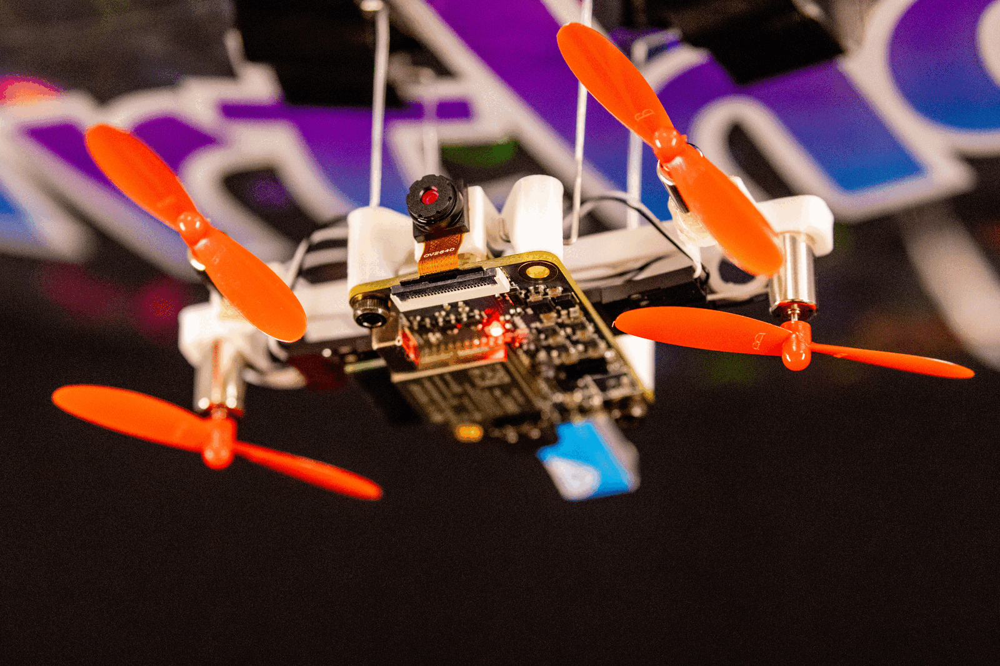
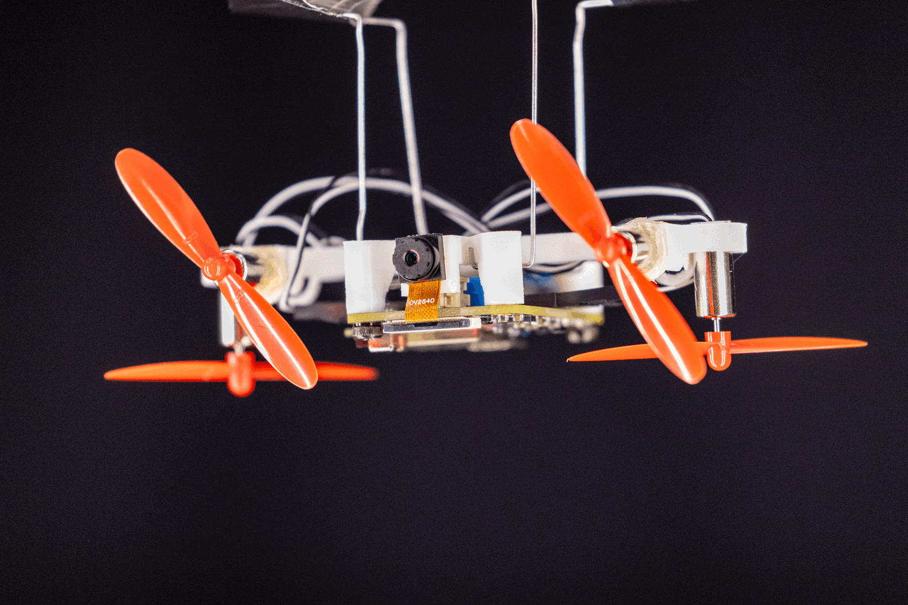
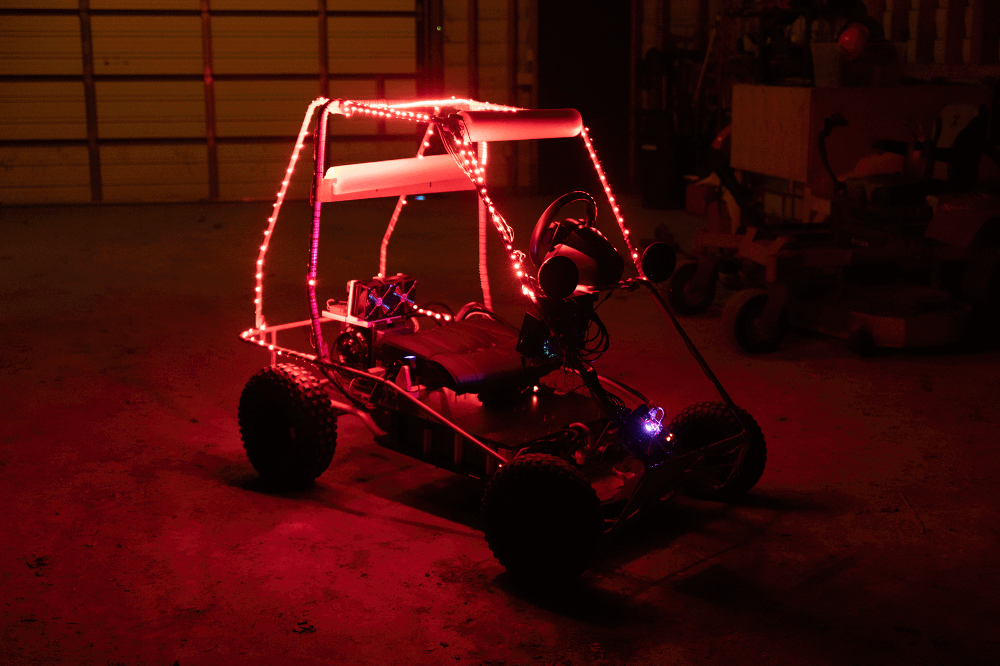
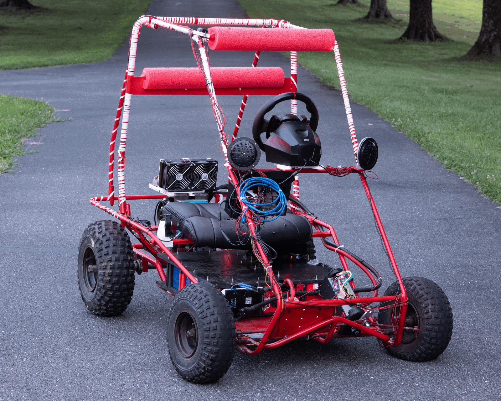
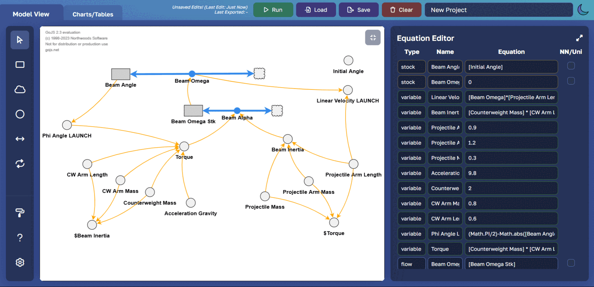
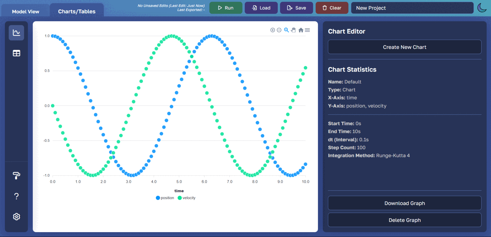
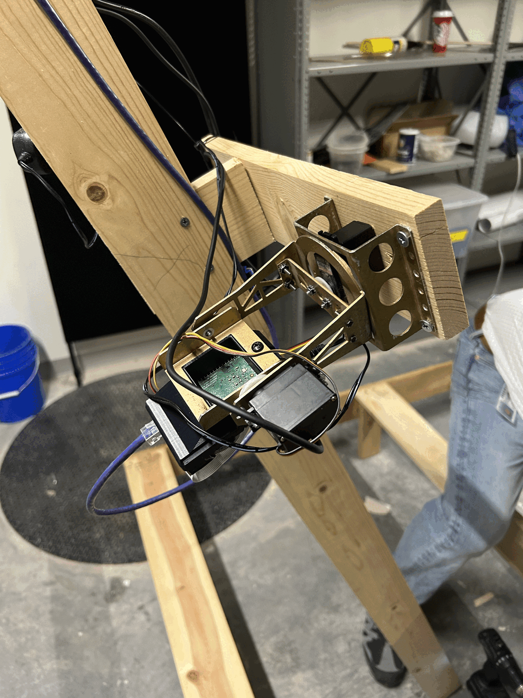
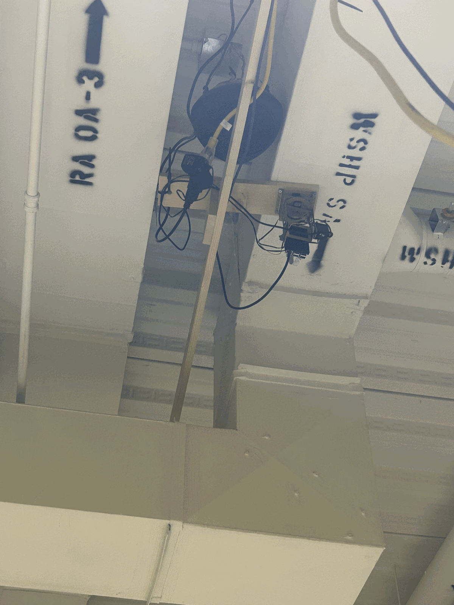

# Poolesville High School
### Science, Math, and Computer Science

[Blimp](#-blimp) · [Gokart](#-gokart) · [LunaSim](#-lunasim) · [Sky](#-sky)

---

This is an early version of what *should* become a continually updated, thriving space where students can find resources for different projects and share their code once a project is done. All of these projects were done by SMCS students!

Please move any repos related to these projects here! Owners will handle read/write permissions and make sure that protected branches stay... protected. See below for some examples.

---

## Falcon-Core (Blimp Project)

Generational improvement of the autonomous blimp project with improved sensors, power management, integration, and efficiency.

  
  

 

##  SMCSKart

A fully remote-controlled electric vehicle, with a custom touchscreen dashboard, liquid-cooled drivetrain, and drive-by-wire steering.

  
  

 

## 🌙 LunaSim

System Dynamics Software officially recognized by the System Dynamics Society.

  
  

 

## 🌌 Sky

Artificial satellite orbiting planet Falconia, once capable of real-time visible light mapping of the exoplanet's surface...

  
  

---

